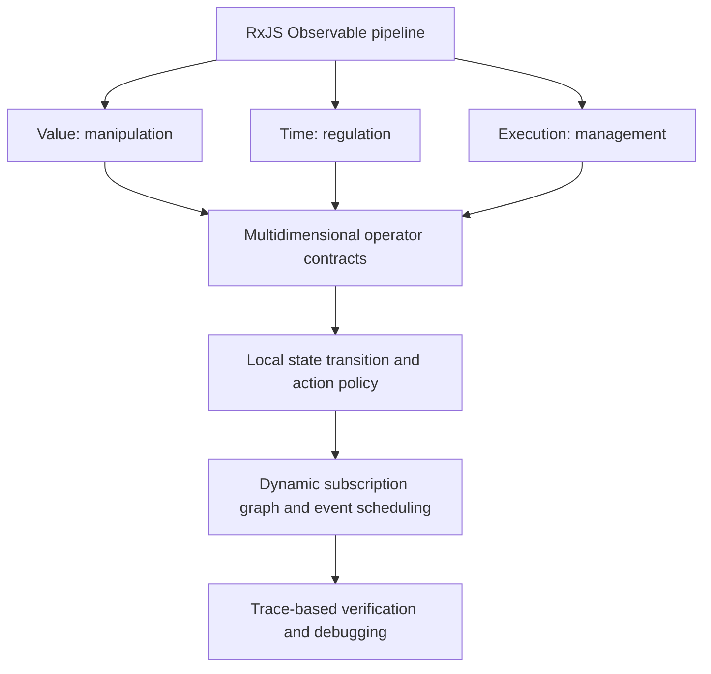

# RxJS Semantics

**Value Algebra · Temporal Semantics · Execution Policies**

A research and teaching project investigating RxJS as an embedded domain-specific language for the composition of value transformations, temporal policies and execution policies.

> What flows? When does it flow? How are the computations producing it executed?

## Central thesis

An Observable describes a dataflow; its subscriptions give rise to executions. The meaning of an operator cannot be recovered from its value type alone. A useful account of reactive behavior must describe three complementary dimensions:

| Dimension | Question | Semantic concern |
| --- | --- | --- |
| Value | What flows? | Selection, transformation, accumulation and structure |
| Time | When does it flow? | Timing, event ordering, regulation and synchronization |
| Execution | How does it run? | Activation, cancellation, termination, concurrency, recovery and sharing |

The dimensions are perspectives, not a partition of operators or mathematically independent axes. For instance, `switchMap` transforms values into descriptions of computations, coordinates events and replaces active subscriptions. `timeout` connects a temporal condition with an execution consequence. `shareReplay` combines execution sharing with retained history.

## Reading paths

| Resource | Purpose |
| --- | --- |
| [Original notes](research/original-notes.md) | Preserve the motivating proposal of 25 November 2026 |
| [Three-dimensional framework](docs/dimensions.md) | Vocabulary, classification, policies and operator matrix |
| [Formal model](docs/formal-model.md) | Timed notifications, local state machines, global execution and equivalence |
| [Operator contracts](docs/operator-contracts.md) | Worked contracts and edge cases across the dimensions |
| [Composition and case study](docs/composition.md) | Live search, state, errors, scheduling and sharing |
| [Related work: Zhao and Li](research/related-work.md) | REBLS 2022 paper and its implementation; complementary models |
| [Research paper draft](research/paper.md) | Research questions, proposed contribution, method and limitations |
| [Lecture series](course/lectures.md) | 15 lectures: intuition → specification → verification |
| [Verification roadmap](research/verification.md) | Trace semantics, experiments and falsifiable obligations |
| [Contributors](CONTRIBUTORS.md) | Research and AI-assisted authorship credit |

## Prior work and companion projects

- [Semantics of RxJS — Tian Zhao and Yonglun Li, REBLS 2022](https://doi.org/10.1145/3563837.3568340): selected-operator small-step semantics, dynamic subscription graph and event queue.
- [rxjs-semantics-tian-zhao](https://github.com/hansschenker/rxjs-semantics-tian-zhao): annotated reference implementation and debugging design.
- [rxjs-operator-cards](https://github.com/hansschenker/rxjs-operator-cards): concise behavior contracts.
- [rxjs-formal-way](https://github.com/hansschenker/rxjs-formal-way): compositional semantics and generation of artifacts.
- [rxjs-operator-behavior-set-notation](https://github.com/hansschenker/rxjs-operator-behavior-set-notation): state transition and action policy.
- [rxjs-type-notation](https://github.com/hansschenker/rxjs-type-notation): structural type vocabulary.
- [rxjs-inspector](https://github.com/hansschenker/rxjs-inspector): runtime observation.
- [rxjs-effects](https://github.com/hansschenker/rxjs-effects): typed effect abstractions.

These repositories supply complementary perspectives, not evidence that the proposed framework is already proved.

## Status

Research foundation v0.1, 25 November 2026. Target reference: RxJS 7.8.2. The taxonomy, trace abstraction and proposed machine rules are working hypotheses, not an official RxJS specification or a claim of a new peer-reviewed result. Examples and obligations are illustrative until tested against the pinned implementation. This is initially a documentation and research repository, not a replacement for RxJS.

## Contributors

- **Hans Schenker** — original three-dimensional framing, research direction and project owner.
- **myProfessorAstra-62 (ChatGPT, GPT-6.2 by OpenAI)** — principal AI-assisted contributor to the synthesis, formalization proposal, research draft and teaching materials.

The published work of Tian Zhao and Yonglun Li is credited separately as related research; they are not contributors to this repository.
