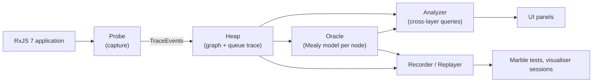

# RxJS Debugger Prototype: a Concept Sketch

This is a design sketch, not an implementation. It names the parts of a debugger for real RxJS 7
applications and says, for each part, whether it comes from the subscription-graph semantics of the paper
behind this repository or from the Mealy-machine analysis of operators developed in the companion
repositories. The comparison of the two models is in [debugging-tool-design.md](debugging-tool-design.md);
this document assumes that reading and goes one level more concrete.

## 1. Guiding principle

The paper supplies the **world model**: a heap of subscription nodes, the edges between them, the queue
that orders events, and the lifecycle rules for subscribe, unsubscribe, and error propagation. The Mealy
tables supply the **node model**: for one operator, what it remembers and what each notification must do
to that memory. The debugger is the world model with every node annotated by its node model.

Two consequences follow. Nothing in the node model needs RxJS internals, because a Mealy machine is
defined over notifications alone. And nothing in the world model needs to know what an operator means,
because edges, ordering, and lifecycle are the same for every operator. The two layers can be built
independently and only meet in the analyzer.

## 2. Components



### 2.1 Probe (capture)

Source of ideas: the paper's observation that the dataflow graph is implicit in RxJS and must be made
explicit; this repository's `Subscription` objects show what to capture.

- A tracing operator is placed between every pair of operators in a `pipe`, either by patching `pipe` in
  development builds or by a build-time transform. Each probe sees notifications entering its node,
  notifications leaving it, and the node's subscribe and unsubscribe.
- A "current node" context stack records which node is delivering at any moment. An inner subscription
  created while node N is delivering becomes a child of N. This is exact under the default scheduler,
  because delivery is a nested synchronous call; it is the probe's version of the paper's rule that
  internal events go to the front of the queue.
- Scheduler hooks log timer scheduling and firing so that time becomes an input letter rather than an
  invisible side effect.
- Each operator call site records its **build location** (file, line, column) at pipeline construction
  time, exactly as `debugging/rxjs.js` does with `_getCallerLocation()`.

Output: a stream of trace events with a monotonic sequence number and a timestamp:

```
subscribe(node, parent, buildLocation)
unsubscribe(node, cause: 'downstream' | 'complete' | 'error' | 'explicit')
notify(node, direction: 'in' | 'out', kind: 'next' | 'error' | 'complete', value, fromNode)
timer(node, phase: 'scheduled' | 'fired' | 'cancelled', due)
```

### 2.2 Heap (graph layer)

Source of ideas: the paper's heap `H` and queue `Q`; this repository's emitter ring buffer and `Progress`
tree.

A node is the paper's subscription value with the fields this repository already keeps:

```
Node {
  id, operator, args (names only), buildLocation,
  sources: [id], children: [id],           // the paper's r references
  latestSource: id,                        // which source fired last; needed for multi-source nodes
  lifecycle: active | completed | errored | unsubscribed,
  guardedBy: id,                           // nearest catchError or root (safe.js's checkpoint)
  recent: ring buffer of the last k notifications in and out, with sequence numbers
}
```

The heap also keeps the **queue trace**: the global order of notifications, each marked as external (DOM,
timer, promise; the paper's back of the queue) or internal (synchronous delivery; the front of the queue).
With that mark the debugger can reconstruct the paper's `Q` at any sequence number, which is what makes
reentrancy visible instead of mysterious.

Operations the heap answers on its own, with no operator knowledge:

- `path(node)`: follow `sources` and `latestSource` back to the primitive producers. This is the dataflow
  half of the paper's reactive stack trace.
- `alive(seq)`: the set of live nodes at a point in time, for "which inner subscription was running".
- `safe()`: the paper's invariant, rechecked from the stored `guardedBy` checkpoint whenever `concat`,
  `catchError`, or a flattening operator adds a node.
- `collateral(node)`: every node unsubscribed as a consequence of this node's unsubscribe, which is the
  `Progress` cascade made queryable.

### 2.3 Oracle (semantic layer)

Source of ideas: the Mealy six-tuples and transition tables of the companion repositories.

- A registry maps operator names to machine-readable models (the `transitions.json` form already used in
  the Mealy analysis repository).
- For every live node, an instance of its model is fed the node's input letters in queue order: in-bound
  notifications tagged with the source they came from, timer firings, and cancellation. The instance
  yields the node's **current state** and the **predicted outputs** for each transition.
- Predicted outputs are compared with the node's actual out-bound notifications. A mismatch is a
  divergence and names the transition row that was violated.
- Value-dependent operators (`filter`, `takeWhile`, `distinctUntilChanged`) cannot predict a value without
  evaluating user code. The oracle treats their predicate result as an input letter inferred from what the
  node actually did (pass or drop), so conformance checks structure, ordering, and lifecycle rather than
  values. This is the same boundary the Mealy method already draws.
- Transitions that happen while the queue trace shows reentrancy are marked "unverified" rather than
  judged, respecting the method's stated reentrancy boundary.

### 2.4 Analyzer (cross-layer queries)

This is the only component that uses both models at once.

| Question | Heap contributes | Oracle contributes |
|---|---|---|
| Why did this value come out here? | The dataflow path through `latestSource` | The transition row at each node on the path ("take: n was 1, emitted and completed") |
| Why did the whole pipeline stop? | The error's path to the root through R_Error, and which `catchError` nodes it passed | The `catchError` row that fired, and the fromEvent node's forced `unsubscribed` state |
| Is error handling adequate? | The `safe` invariant over `guardedBy` | Which states each guarded source can still reach |
| Is something leaking? | Nodes still alive after their root unsubscribed | Nodes in an absorbing (stopped) state that are still subscribed |
| Did an operator misbehave? | Nothing | Divergence between predicted and actual outputs |
| Why did nothing ever come out? | Which sources never emitted | The named stuck state, for example `combineLatest: waiting, source B completed empty` |

### 2.5 Recorder and replayer

A session is the list of tuples `(seq, node, input letter, state before, state after, outputs)`. The
paper's conclusion that the default scheduler is deterministic is what makes replay sound: feeding the
same external events in the same order reproduces the same heap and the same states. Export targets:

- marble tests, one per observed transition row, through the mealy-to-testcase pipeline;
- sessions for the frame-by-frame visualiser;
- a diffable text form for regression checks between two runs.

### 2.6 UI panels

- **Graph panel.** The live heap. Node label is `operator` plus the oracle's state name. Dead nodes are
  greyed, `catchError` nodes are drawn as enclosures around the subgraph they guard, `share` nodes are hubs
  showing their reference count.
- **Timeline panel.** The queue trace as one lane per node in marble style, with external and internal
  events marked differently and a scrubber that drives the replayer.
- **Node inspector.** Current Mealy state, the last k notifications in and out, the transition history,
  alerts, divergences, and the build location.
- **Reactive stack trace.** On an error: the dataflow path from the failing node to its sources, followed
  by the trimmed JavaScript frames and the build location. These are the paper's three trace types in one
  view, and the first two already exist as `rxGraphTrace` and `RxError.stack` in `debugging/rxjs.js`.
- **Alerts.** Named-state alerts from the oracle, `safe` violations and collateral unsubscribes from the
  heap, divergences from the comparison.

## 3. Alerts as named states

The paper lists "unexpected states" informally in its Section 4.2. In the prototype each one is a state
of a Mealy model with an alert flag, which generalises the list to every operator with a model:

| Paper's informal alert | Oracle state that triggers it |
|---|---|
| A `combineLatest` source completed before emitting | `combineLatest: source i completed empty` |
| The first source of `concat` completed without emitting | `concat: first completed empty` |
| `every` completed without input and emitted `true` | `every: vacuous true` |
| A `switchMap` inner was cancelled before emitting | `switchMap: inner cancelled at 0 emissions` |
| (from the heap) a producer unsubscribed while its root is alive | `lifecycle = unsubscribed` on a primitive node whose root is active |

## 4. Walkthrough: the paper's type-ahead bug

Pipeline A, the buggy one, with `catchError` after `switchMap`:

1. The graph panel shows root, then `catchError`, then `switchMap` with `map` and `fromEvent` as its source
   chain and `from(query)` as its child. The `catchError` enclosure contains both primitives.
2. `safe()` reports that one guard covers two sources, using the paper's rule that a guard or the root may
   cover one.
3. A query fails. The timeline shows the error leaving `from(query)`, entering `switchMap`, and arriving at
   `catchError`, which handles it. The oracle shows `catchError`'s row: on error, unsubscribe the source and
   subscribe to the replacement. The heap's `collateral(switchMap)` lists `map` and `fromEvent`.
4. The alerts panel shows the `fromEvent` node as unsubscribed while the root is still alive. The node
   inspector on `fromEvent` shows cause `downstream`.
5. The reactive stack trace reads `['catchError', 'switchMap', 'from']` plus the frame in `query` that
   threw and the build location of the `switchMap` call.

Pipeline B, with `catchError` inside the projection: the enclosure now contains only `from(query)`,
`safe()` passes, a failed query shows the replacement observable emitting under the same `switchMap`
child slot, and `fromEvent` stays active.

## 5. What is deliberately out of scope for a prototype

- Async and animation-frame schedulers. The context stack breaks across a queue hop; a later version
  needs zone-style or AsyncContext propagation, and the queue trace tells exactly which events need it.
- Breakpoints on construction-time expressions such as `take(n)`. The paper notes these were not
  implemented; the inspector's build location is the substitute.
- Capturing operator arguments. Closures are opaque; the probe records names and build locations only.
- Production use. Ring buffers and probes cost memory and time; the prototype is a development build.

## 6. Open design choices

- **Root budget.** The paper lets the root subscriber guard one source; `debugging/safe.js` in this
  repository uses zero. The prototype should follow the paper, since the paper's own correct example
  depends on it.
- **Probe placement.** Patching `pipe` is simplest but misses operators applied without `pipe`; a lift
  hook or a build transform is more complete and more invasive.
- **Model fidelity.** Whether to run the oracle live or only on recorded sessions. Live gives alerts as
  they happen; recorded keeps the probe cheap.

## 7. Order of work, if it were built

1. Probe and heap with `path()` and the ring buffers, exercised on the paper's type-ahead example from
   `test/recipes/type_ahead.html` and `test/error_handling/catch3.js`.
2. Oracle for `take`, `switchMap`, `combineLatest`, and `catchError`, with the four named-state alerts.
3. `safe()`, the reactive stack trace panel, and session export to marble tests.
