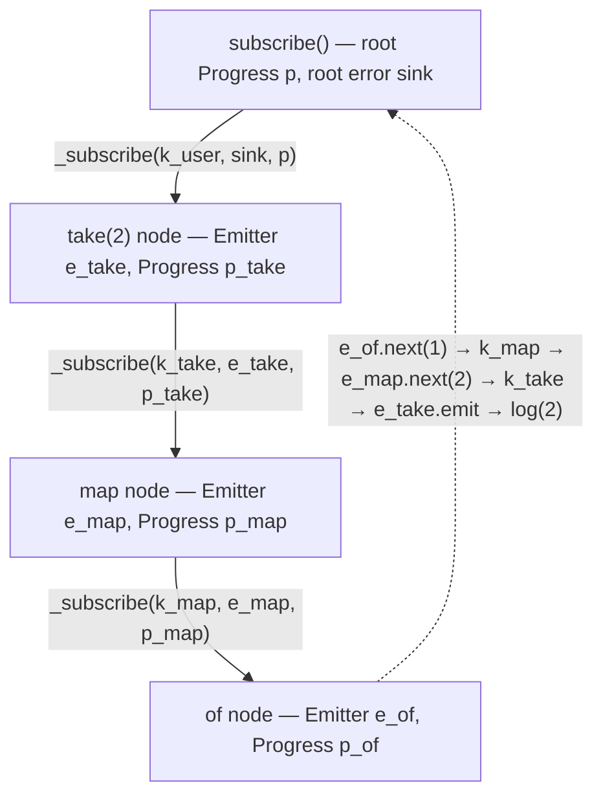

# rxjs-semantics — Project Explanation

## 1. What this project is

This repository is a from-scratch re-implementation of the RxJS API (observables, roughly one hundred
operators, and the Subject family) in a single plain-JavaScript file, `rxjs.js`. It is not meant to replace
RxJS. Its purpose, stated in the README, is **to understand the semantics of RxJS computation and to provide
an easier way to debug RxJS programs**.

The central idea is that an observable is a **thread**: a cancellable asynchronous computation that writes
events into an emitter. Operators are small concurrent programs written against a handful of classic
concurrency primitives, namely a cancellation tree (`Progress`), an asynchronous monad (`AsyncM`), event
emitters, Haskell-style `MVar`s, and bounded channels. Because those primitives are explicit, what each
operator *means* (what it subscribes to, when it cancels, how it decides it is complete, where errors go) is
spelled out in a few lines of readable code instead of being hidden inside a framework.

A second goal is debuggability. A parallel build in `debugging/` adds filtered stack traces, a captured
"subscription graph" attached to every error, and a runtime invariant checker (`safe`) that walks a live
subscription tree.

History: `tianzhao` wrote the core between August 2021 and August 2023; `Alan Li` added the debugging
facility in November and December 2022. There are 24 commits and no git remote configured.

### 1.1 The paper behind the project

The code is the implementation companion of **"Semantics of RxJS"** by Tian Zhao and Yonglun Li
(University of Wisconsin–Milwaukee), published at REBLS '22, the 9th ACM SIGPLAN International Workshop on
Reactive and Event-Based Languages and Systems, Auckland, December 2022,
DOI [10.1145/3563837.3568340](https://doi.org/10.1145/3563837.3568340). Section 5 of the paper describes
this code base directly ("100 RxJS operators with about 2500 lines of code", `github.com/tianzhao/rxjs`).
A local copy of the PDF lives at `../rxjs-rag/files/rxjs-semantics-rebls2022.pdf`. The REBLS talk is on
YouTube as "[REBLS] Semantics of RxJS":
[youtube.com/watch?v=GsGVbj6wKJY](https://www.youtube.com/watch?v=GsGVbj6wKJY&t=1055s) (the link opens at
17:35, where the implementation is discussed).

The paper's argument has four parts:

1. **Motivation (Section 2).** Debugging RxJS is hard because the call stack at a breakpoint says nothing
   about the dataflow graph. The running example is a type-ahead client. Placing `catchError` *after*
   `switchMap` kills the whole client on the first failed query, because that `catchError` guards the
   `switchMap` and therefore the `fromEvent`, not the inner `from(query(x))`. Moving it inside the
   projection fixes it. This repository reproduces exactly that pair of pipelines in
   `test/error_handling/catch3.js` and the type-ahead itself in `test/recipes/type_ahead.html`.
2. **λrx, a small-step operational semantics (Section 3)** for a representative subset: `fromEvent`,
   `combine` (combineLatest), `concat`, `every`, `catchError`, `share`, `take`, `map`, `switchMap`, plus
   `sub` and `unsub`. The runtime state is a **heap H** of subscription values linked by references (the
   subscription graph) and a **queue Q** of (event, reference) pairs. Evaluation alternates between a
   graph-construction phase (subscribe and unsubscribe rules) and a reactive phase (reduction rules that
   pop an event and deliver it to the subscriber). External events are appended to the back of Q, like
   JavaScript macrotasks; internal events are pushed to the front, which models the default synchronous
   scheduler. Pushing them to the back instead would model the async scheduler. Errors are forwarded to
   the subscriber by default (rule R_Error) unless a `catchError` handles them (R_Catch), and `share` is
   reference counted.
3. **Debugging applications of the model (Section 4).** Three kinds of stack trace for reactive programs
   (construction-phase frames, reactive-phase dataflow paths, and a dataflow path followed by frames when
   user code such as a `switchMap` projection throws); "unexpected state" alerts, for example a
   `combineLatest` source that completes without emitting or a `switchMap` inner that is cancelled before
   emitting; and a **runtime safety invariant** `safe_H(s, n)`, meaning at most n event sources below s
   are not guarded by a `catchError` or the root subscriber. Because `concat`, `catchError`, and
   `switchMap` add subscriptions at runtime, the heap must be rechecked when they fire.
4. **Implementation (Section 5)**: this code base, built on AsyncM, the authors' cancellable-thread monad
   from their SLE 2021 paper "A Concurrency Model for JavaScript with Cooperative Cancellation". The paper
   notes two deliberate departures from the formal model: there is no explicit event queue (promises and
   synchronous emitters play that role), and sources are reached through variables while events flow
   downstream through emitter objects rather than bidirectional heap references.

The conclusion observes that under the default scheduler the semantics is deterministic, since JavaScript
is single-threaded and internal events are always processed before the next external one. Section 12 of
this document maps the paper's constructs onto the code.

## 2. Repository layout

```
rxjs.js                 the whole library (~2 500 lines, browser globals, no build step)
README.md               short description and usage notes
debugging/
  rxjs.js               fork of rxjs.js with debugging instrumentation (~2 800 lines)
  safe.js               runtime invariant checker for subscription trees
  stack.html            demo: filtered stack trace plus subscription-graph trace
  safe.html             demo: safe(subscription)
  README.md             documents the two debugging facilities
test/
  test.html             harness: loads jQuery, ../rxjs.js, and one test script
  combination/          35 files      conditional/      11 files
  creation/             21 files      error_handling/    6 files
  filter/               49 files      multicasting/      5 files
  transformation/       51 files      utility/          11 files
  recipes/              25 standalone HTML apps (games, type-ahead, stopwatch, HTTP poll, ...)
```

The only dependency is jQuery, loaded from a CDN, and it is used solely by `fromEvent` and `ajax`.
There are no modules, no npm, no TypeScript; everything is attached to the browser's global scope.

## 3. How to run things

- Open `test/test.html` in Chrome and look at the console. Edit the line
  `<script src="filter/take.js"></script>` to point at a different test file.
- Tests that need DOM elements (buttons, inputs) ship their own `.html` next to the `.js`
  (for example `test/transformation/switchMap2.html`).
- Everything under `test/recipes/` is a self-contained page.
- `debugging/stack.html` and `debugging/safe.html` demonstrate the debugging build.

The README notes that only the default scheduler is supported (events are delivered synchronously) and that
not every option of every RxJS operator is implemented.

## 4. Architecture: five layers inside `rxjs.js`

The file is organised as a stack. Each layer only depends on the ones below it.

| Layer | Classes | Role |
|---|---|---|
| 5 | `Observable`, `Subject` family, `Subscription`, exported operator constants | The RxJS API |
| 4 | `Next`, `Ended`/`End`, `Error` | The event vocabulary |
| 3 | `Emitter`, `MVar`, `MChannel` | Communication between threads |
| 2 | `AsyncM` | The asynchronous monad: a thread is an `AsyncM` run against a `Progress` |
| 1 | `Progress` | Structured cancellation |

### 4.1 `Progress`: the cancellation tree

A `Progress` is a node in a tree of cancellation scopes.

- `cons()` creates a child; `unlink()` detaches a finished child so the tree does not leak.
- `addCanceller(c)` registers a teardown function (clear a timer, remove a DOM listener, remove a
  Subject observer, run a `finalize` callback).
- `cancel()` is idempotent. It marks the node cancelled, runs its cancellers **synchronously**, then cancels
  every child. The source comment explains why synchronously: a cancelled thread must not get a chance to
  perform any action between the cancellation request and its teardown.
- `isAlive()` is polled by loops such as `of` and `generate` so they stop producing once cancelled.
- `pause()` / `resume()` / `isPaused(k)` can park continuations. The operator library never uses them;
  they belong to the general-purpose runtime.

Every subscription owns a `Progress`, and a subscription's inner subscriptions own children of it. That is
what makes `unsubscribe()` tear down an entire pipeline, including inner observables of `switchMap`,
pending timers of `delay`, and so on.

### 4.2 `AsyncM`: the asynchronous monad

`AsyncM` wraps a function `run :: Progress -> Promise a`. It is a reader monad over `Progress` layered on
top of promises, and it is the type of every observable's thread body.

Key members:

- `pure`, `throw`, `fmap`, `bind`, `join`, `app`, `seq`, `catch`: the usual monad plumbing. `bind` accepts
  a continuation that returns either an `AsyncM` or a plain value.
- `lift(f, h)`: the single most important constructor. It wraps a callback-style asynchronous action `f`
  and a teardown `h`. When the progress is cancelled, the teardown runs and the promise rejects with the
  sentinel string `"interrupted"`. If the progress is already dead, `f` never runs at all.
- `_run(p)` runs and swallows `"interrupted"` rejections, so cancellation is silent.
- `timeout(n)`: `setTimeout` with `clearTimeout` as teardown. This is the only timing primitive, and
  `delay`, `timer`, `debounceTime`, `throttleTime`, `auditTime`, and `timeout` all reduce to it.
- `from(elem, evt)`: a one-shot jQuery listener with `off` as teardown.
- `_lift(promise)`: makes a promise interruptible (the continuation is dropped on cancel).
- `ifAlive`, `cancel`, `commit`, `never`, `all`, `race`, `any`, `fork`, `spawn`, `start`, `loop`, `while`,
  `if`, `block`: the rest of a small structured-concurrency toolkit.

Of these, the operator library only needs `timeout`, `lift`/`_lift`, `from`, `all`, `ifAlive`, `never`,
`pure`, `throw`, `fmap`, `bind`, `catch`, and `run`/`_run`. `fork`, `spawn`, `race`, `any`, and
pause/resume are part of the runtime but not exercised by any operator.

### 4.3 `Emitter`, `MVar`, `MChannel`: communication

- **`Emitter`** has a list of listeners and a ring buffer of the last five events (`Emitter.size`).
  `emit(x)` appends to the buffer and calls every listener **synchronously**. `next`, `complete`, and
  `error` wrap values in the event classes below. Listeners are never removed; a cancelled producer simply
  stops emitting. The ring buffer exists for debugging: `Subscription.toString()` prints it.
- **`MVar`** is the Haskell primitive: `put` blocks while full, `take` blocks while empty, `read` blocks
  while empty without emptying. Blocked operations are cancellable, and a blocked operation that is woken
  up resumes on `setTimeout(..., 0)` "to simulate waking up a thread". This is the only place where the
  library introduces an asynchronous hop that the user did not ask for.
- **`MChannel`** is a bounded FIFO built from an array plus one `MVar` used as a hand-off slot when the
  buffer is empty, full, or has waiting readers. Default capacity is unbounded. It is used by `concatAll`
  (a queue of inner observables) and `zip` (one queue per source).

### 4.4 The event vocabulary

```js
class Next  { constructor(value) }   // a value
class Ended { }                       // the singleton End
class Error { constructor(value) }   // an error carrying its payload
const End = new Ended()
```

Note that `class Error` **shadows the global `Error`** in the main build. The debugging build renames it
`ErrorEvent` because it needs the real `Error.captureStackTrace`.

### 4.5 `Observable`: the engine

An `Observable` is just a name plus an **effect function**:

```js
constructor(ef, name)   // ef :: (Emitter, Subscription) -> AsyncM ()
```

Nothing runs until somebody subscribes. The engine is three short methods at the bottom of the class.

**`_subscribe(k, e, p, f)`** — the internal subscription protocol, used by every operator:

1. `e1 = new Emitter()` — the output emitter of this node.
2. `p1 = p.cons()` — a child progress, so this node is cancelled whenever its parent is.
3. `s = new Subscription(this.name, e1, p1)` — the node object. Operators store what they subscribed to in
   `s.source` and `s.child`, which is how the subscription graph becomes inspectable.
4. A finalizer `f1` (the optional user finalizer `f`, then `p1.unlink()`) is registered as a canceller on
   `p1` and is also called when `End` arrives.
5. `_listen(e1, ...)` installs the single listener on `e1`:
   - an `Error` event goes to `e.emit(x, p1)`, that is, **straight into the downstream emitter**; the
     operator's handler `k` never sees it;
   - a `Next` whose value is a `Promise` is first converted with `fromPromise`;
   - `Next` and `End` go to `k(x, p1)`; the handler receives this node's progress so it can cancel it;
   - after `End`, the finalizer runs.
6. `this.ef(e1, s)._run(p1)` starts the thread.
7. `s` is returned.

**`subscribe(nextOrObserver, error = console.error, complete)`** — the public entry point. It creates the
root `Progress`, builds a root error sink `{emit: x => { p.cancel(); error(x.value) }}` (an uncaught error
tears down the whole pipeline *before* the user's error callback runs), and calls `_subscribe`. It returns a
`Subscription` whose `unsubscribe()` is `progress.cancel()`.

**`pipe(...fns)`** is a left fold, and the pipeable operator constants at the end of the file are
generated by `make(f) = (...args) => ob => f.apply(ob, args)` from the prototype methods. There are 101
exported names, including `EMPTY`, `NEVER`, `noop`, and `pipe`.

### 4.6 `Subscription`

```js
class Subscription { name, emitter, progress, source, child; unsubscribe(); toString() }
```

`toString()` prints the node name, the last five events of its emitter, and recursively its `source` and
`child`. Logging a subscription therefore yields a rough textual marble diagram of the whole pipeline.

## 5. A worked example

```js
of(1, 2, 3).map(x => x * 2).take(2).subscribe(console.log)
```

Subscription builds the tree top-down and events flow bottom-up, all synchronously:



1. `take(2)` is `takeWhile((_, i) => i < 1, true)` (inclusive). Its `ef` subscribes to the `map`
   observable, whose `ef` subscribes to `of`.
2. `of`'s thread loops over the values while `p.isAlive()`. `e_of.next(1)` synchronously reaches `map`'s
   handler, which emits `2` on `e_map`, which reaches `take`'s handler, which emits on `e_take`, which
   reaches the user's `console.log`.
3. On the second value the predicate fails. Because the operator is inclusive, `4` is still emitted; then
   the handler calls `p1.cancel()` on the progress of the `map` node (which also cancels `of`) and emits
   `End`. Back inside `of`'s loop, `p.isAlive()` is now false, so `3` is never produced.

If `map`'s projection had thrown, `fmap` would have caught it and called `e_map.error(ex)`. The listener
installed on `e_map` by `take`'s `_subscribe` forwards an `Error` directly into `e_take`, whose listener
forwards it to the root sink, which cancels `p` (running every registered teardown) and then calls the
user's error callback.

## 6. How operators are written

Almost every operator follows one template: build an `ef` that subscribes to the source with a handler
`k`, keep a little local state in closure variables, write to the output emitter `e`, and record the
subscriptions on `subscription.source` / `subscription.child`.

```js
scan (accumulator, seed) {
  let ef = (e, subscription) => new AsyncM(async p => {
    let c = seed
    subscription.source = this._subscribe(x => {
      if (x == End) e.complete()
      else { c = (c == undefined) ? x.value : accumulator(c, x.value); e.next(c) }
    }, {emit: x => e.emit(x)}, p)
  })
  return new Observable(ef, 'scan')
}
```

The recurring patterns are listed below, because each one encodes a piece of RxJS semantics.

### 6.1 Stateful relays

`fmap`/`map`, `filter`, `scan`, `distinct*`, `pairwise`, `takeWhile`, `skipWhile`, `takeLast`,
`toArray`, `count`, `every`, `defaultIfEmpty`. They forward `End`, keep an index or an accumulator, and
when they need to stop early they call `p1.cancel()` on the progress they were handed and then
`e.complete()`.

### 6.2 Higher-order flattening

These operators receive observables as values (recall that `_listen` already turned promises into
observables) and differ only in their bookkeeping of inner subscriptions and completion.

- **`join()`** is "switch": on every new inner observable it calls `subscription.child.unsubscribe()` on
  the previous one. A flag `ending` tracks whether the outer has completed so that `End` is emitted only
  after both the outer and the last inner complete. `switchMap(f) = fmap(f).join()`, `switchAll = join`,
  `switchMapTo(ob) = switchMap(_ => ob)`.
- **`mergeAll(concurrent)`** keeps a `count` of active inners and a `buffer` of inners waiting for a slot.
  `mergeMap(f, selector, concurrent) = fmap(f).mergeAll(concurrent)`.
- **`concatAll()`** writes each inner observable into an `MChannel` and reads them one at a time,
  subscribing to the next only after the current one ends. `concatMap(f) = fmap(f).concatAll()`.
- **`exhaustMap(f)`** uses a `ready` flag and ignores outer values while an inner is active.
- **`expand(f, concurrent)`** is `mergeAll` where every emitted value is also fed back through `f`.
- **`mergeScan`** is built on `fix` (see 6.6) plus `withLatestFrom` and `mergeAll`.

Reading these five functions side by side is the fastest way to learn the exact completion rules that
distinguish `switchMap`, `mergeMap`, `concatMap`, and `exhaustMap`.

### 6.3 Combination

- `merge` counts `End`s; `combineLatest` keeps per-source "has emitted" flags; `withLatestFrom` keeps a
  `latest` array and unsubscribes the side inputs when the main source ends; `forkJoin` stores the last
  value of each source and emits once all have ended; `race` unsubscribes the losers on the first event.
- **`zip`** is the most "thread-like" operator: one `MChannel` per source, and a loop that does
  `AsyncM.all(channels.map(ch => ch.read))` to wait for one value from every source before emitting a tuple.
- `concat` subscribes to the next source on `End`; `startWith` and `endWith` are `concat` with an `of`.

### 6.4 Time

- `timer(d, dt)` is `AsyncM.timeout(d)` followed by `interval`; `interval` is a `setInterval` whose
  `clearInterval` is registered as a canceller.
- `delay(dt)` starts an `AsyncM.timeout` per event and emits when it fires.
- `debounce(selector)` subscribes to `selector(value)` on every event and cancels the previous one;
  `debounceTime(dt) = debounce(_ => timer(dt))`.
- `throttle(selector, {leading, trailing, auditing})` is a single implementation that also serves
  `throttleTime`, `audit`, and `auditTime`.
- `timeout(due)` and `timeoutWith` race a timer against each event.

Scheduler arguments are ignored throughout; the README explains that only the default synchronous
scheduler is supported.

### 6.5 The error side-channel

Because `_listen` sends errors straight to the downstream emitter, an operator that wants to *see* errors
must pass its own sink object instead of `e` to the upstream `_subscribe`:

- `catchError(f)`: the sink cancels the failed upstream (`p1.cancel()`) and subscribes to `f(error)`.
- `retry(n)`: the sink re-subscribes to the source up to `n` times.
- `retryWhen(notifier)`: the sink feeds the error into `notifier(of(error))` and re-subscribes on its
  next value, completing when the notifier completes.
- `tap({error})` calls the callback and forwards; `scan` simply forwards.

`throwError(ex)` is `of(null).map(_ => { throw ex })`.

### 6.6 Multicasting: the `Subject` family

`Subject extends Observable`. Its `ef` adds the subscriber's `Subscription` to a `subscribers` list and
returns a thread that only registers a canceller to remove it again. `_fire(x)` pushes `x` into every
subscriber's emitter. `connect()` subscribes the subject to its underlying observable with a **fresh root
`Progress`**, so the connection's lifetime is independent of any individual subscriber.

- `BehaviorSubject` emits its current value to each new subscriber.
- `RefCountSubject` connects on the first subscriber and disconnects on the last. `share()` returns one.
- `ReplaySubject(bufferSize, refCount, observable)` buffers fired events and replays them. `shareReplay`
  returns one.
- `publish(selector?)` returns a `Subject` (connected if a selector is given); `multicast(subjectOrFactory)`
  attaches the source to a caller-supplied subject.
- `groupBy` puts a `Subject` in front of the source so that each group can subscribe to the same stream
  without re-running the producer.
- `Observable.fix(f)` ties a recursive knot: a `Subject` whose source is `f(subject)`. `mergeScan` uses it.

### 6.7 Creation

- `of`, `generate`, and `range` are plain loops guarded by `p.isAlive()`.
- `from` dispatches on promise, array, string, `Map`, or plain object; the promise case uses
  `AsyncM._lift` so the pending promise is interruptible.
- `create(subscribeFn)` hands the user an observer object and registers the function's return value as
  the teardown.
- `defer(factory)` is literally `factory().ef(e, subscription)`.
- `fromEvent` is an infinite loop of one-shot jQuery listeners; `ajax` wraps `$.ajax` in a promise.
- `empty` is `of()`, `NEVER` is an observable whose thread is `AsyncM.never`.

### 6.8 Operators defined by composition

Many public operators are one-liners over others, which is itself a semantic statement:
`take = takeWhile(inclusive)`, `first = filter + take(1)`, `find = filter + take(1)`, `single = filter +
take(1)`, `skip = skipWhile`, `reduce = scan + last`, `mapTo = fmap`, `pluck = fmap`, `startWith/endWith =
concat`, `auditTime = audit(timer)`, `throttleTime = throttle(timer)`, `debounceTime = debounce(timer)`,
`range = generate`, `concatMapTo = concatMap`, `switchMapTo = switchMap`, `timeoutWith = timeout`.

## 7. The semantics this implementation makes explicit

1. **Cold and unicast by default.** Every `subscribe` builds a fresh tree of emitters and progress nodes
   and runs the producer again. Sharing happens only through a `Subject`.
2. **Synchronous delivery.** `Emitter.emit` calls listeners inline, so `of(1, 2, 3).subscribe(log)` logs
   during the `subscribe` call, exactly as reference RxJS does with the default scheduler. The only
   asynchronous hop the library adds on its own is the `setTimeout(0)` wake-up of a *blocked* `MVar`
   operation inside `concatAll` and `zip`.
3. **Structured, synchronous cancellation.** The subscription tree *is* the `Progress` tree. Unsubscribing
   a node cancels every inner subscription, pending timer, event listener, and subject registration below
   it, and runs `finalize` callbacks, before `unsubscribe()` returns.
4. **Errors bypass operators.** An error travels emitter-to-emitter to the root sink unless an operator
   installs its own sink. The root sink cancels the pipeline first and calls the error callback second.
5. **Completion is local bookkeeping.** Each flattening or combining operator decides on its own when to
   emit `End`, using a handful of counters and flags. The rules are visible in the code.
6. **Promises are observables.** Any `Next` carrying a promise is converted by `_listen`, and
   `fromPromise` is applied explicitly in `combineLatest`, `forkJoin`, `throttle`, and `mergeMap`.
7. **Laziness lives in `ef`.** An observable is a description; `defer` makes that visible by calling the
   factory inside `ef`.
8. **Higher-order operators are composition.** `switchMap = fmap ∘ join`, `mergeMap = fmap ∘ mergeAll`,
   `concatMap = fmap ∘ concatAll`. The method names `fmap`, `bind`, and `join` on `Observable` mirror the
   same names on `AsyncM`, which is the monadic reading the project is built around.

## 8. The debugging build (`debugging/`)

`debugging/rxjs.js` is a fork of the main file with the following additions. The debugging README shows
example output for the first two.

**Filtered stack traces (`RxError`).** `Error.prepareStackTrace` is hooked to keep V8's structured frames.
When a user projection throws inside `fmap` or an inner subscription fails inside `join`, the error is
wrapped in an `RxError` that (a) trims the library's own frames from the stack, (b) appends the *build
location*, the user-code line where the operator was applied, captured by `RxError._getCallerLocation()`
at construction time, and (c) attaches `rxGraphTrace`, produced by `captureSubscriptionGraph(subscription)`,
which is the list of operator names from the failing node back to its sources, for example
`['switchMap', 'of']`.

**Stable operator names.** Each observable now carries `cname`, its canonical name set at construction,
alongside the renamable `name`. The helper `Observable._make(name, ob)` wraps composed operators
(`switchMap`, `mergeMap`, `concatMap`, `switchAll`, `find`, `single`, `reduce`, `throwError`) in a single
named node, so graph traces show the operator the user wrote rather than the `fmap`/`join` it expands to.

**Deferred start.** `_subscribe` no longer runs the `ef`. It returns the `Subscription`, and the caller
calls `.run()` after storing it in `subscription.source` or `subscription.child`. This fixes a race noted
as a TODO in the main build: with a synchronous source, a handler could reference `subscription.child`
before the assignment had happened (`takeUntil`, `buffer`). A static guard `Observable._subscribe(thisval,
...)` also throws a clear `TypeError` when a projection returns something that is not subscribable.

**Tracked roots.** `subscribe()` adds its `Subscription` to the global set `Subscription.tracked` and
`unsubscribe()` removes it, so tooling can enumerate every live pipeline.

**Runtime invariant (`safe.js`).** `safe(subscription)` (or `safe()` for all tracked roots) walks `child`
and `source` links and returns `{roots, isSafe, failedAt?}`. The example rule it enforces: every creation
operator (`of`, `from`, `timer`, `fromEvent`, ...) counts as one potential error producer; a node may not
expose more producers than its budget; the root budget is zero and `catchError` gives its upstream a budget
of one and contributes zero downstream. In words: **every pipeline must be guarded by a `catchError`, and
each `catchError` guards at most one producer.** The demo in `safe.html` shows `of(1).map(query)` failing
and `of(1).map(query).catchError(...)` passing. While walking, `safe` also stamps each `Progress` with a
`WeakRef` to the nearest enclosing checkpoint (`catchError` or root), and `Subscription.run()` re-evaluates
the invariant whenever a new inner subscription starts, so the check can follow a graph that grows
dynamically under `switchMap`. The re-check's console output is currently commented out.

**Other changes.** `Error` is renamed `ErrorEvent`; a `Scheduler`/`Timer` pair sketches coalescing of
timers with equal durations into one `setTimeout`/`setInterval` (not wired into any operator); a `raceWith`
alias is exported.

How these ideas compare with a Mealy-machine view of operators, and how both would fit into a debugging
tool for real RxJS applications, is discussed in [debugging-tool-design.md](debugging-tool-design.md).

## 9. Tests and recipes

The roughly 190 files under `test/` are one-operator examples in the style of learnrxjs.io, each with a
comment stating the expected console output. The README states that all operators were tested, primarily
in Chrome, and that the implementation tries to match reference RxJS as closely as possible. There is no
assertion framework; a test "passes" when the console output matches the comment.

The 25 recipes are complete browser applications built only from this library: games (breakout, flappy
bird, minesweeper, space invaders, tetris, tank battle, ...), UI patterns (type-ahead with
`debounceTime → distinctUntilChanged → switchMap`, a stopwatch driven by `merge → scan → switchMap`,
progress bar, save indicator, swipe to refresh, lock screen), and an HTTP poller. They double as stress
tests for cancellation and timing.

## 10. Differences from reference RxJS and rough edges

Observed while reading the code; useful to know before relying on a result.

- Only the default synchronous scheduler exists; scheduler parameters are ignored.
- `fromEvent` and `ajax` require jQuery.
- Not all operator options are supported (README).
- The main build's `class Error` shadows the global `Error`, so user code loaded after `rxjs.js` that writes
  `new Error('x')` creates an rx event, not a JavaScript error. Use the debugging build if that matters.
- The main build still has the synchronous-source race that the debugging build fixes with `run()`.
- `catchError` does not record the replacement subscription on the `Subscription` object when the handler
  fires synchronously (noted in a comment).
- `concatAll` has no buffer-size parameter yet (TODO).
- `Emitter.listen` never removes listeners; correctness relies on cancelled producers going quiet.
- Typos: `distinctUntilKeyChanged` calls `e.commplete()` on completion, and the `takeLast` name template
  reads `takeLast({size})`.

## 11. Suggested reading order

1. The paper (see 1.1): Section 2 for the motivating bug, 3.4 for event propagation, 4.3 for the safety
   invariant, and 5 for the implementation notes.
2. `rxjs.js` lines 1–415: `Progress`, `AsyncM`, `Emitter`, `MVar`, `MChannel`, and the event classes.
3. The engine at the end of the `Observable` class: `_subscribe`, `_listen`, `subscribe`, `pipe`.
4. `fmap`, `takeWhile`, and `scan` for the basic operator template.
5. `join`, `mergeAll`, `concatAll`, `exhaustMap` for flattening semantics; `zip` for the channel style.
6. `catchError`, `retry`, `retryWhen` for the error side-channel.
7. `Subject`, `RefCountSubject`, `ReplaySubject`, and `fix` for multicasting.
8. `debugging/README.md`, then the `RxError` block and `Subscription.run()` in `debugging/rxjs.js`,
   then `debugging/safe.js`.

## 12. How the code maps to the paper

The table pairs each construct of the paper's λrx model with its counterpart in `rxjs.js`.

| Paper (λrx) | Code |
|---|---|
| Subscription value `s` in heap `H`; references `r` to source and child subscriptions | `Subscription` object with `source` and `child` fields; references are plain object links |
| Events `next(v)`, `end`, `error` | `Next`, `End`, `Error` (`ErrorEvent` in the debugging build) |
| Queue `Q`; internal events pushed to the front | No explicit queue. `Emitter.emit` calls listeners synchronously, which is the front-of-queue behaviour |
| External events appended to the back of `Q` (rule R_From) | DOM events, `setTimeout`, `setInterval`, and promise resolutions arrive through the JavaScript event loop |
| `o.sub(f)` evaluating to `sub(r, f)` (rules E_Sub, R_Sub1–3) | `Observable.subscribe()`: root `Progress` plus a root error sink that cancels everything |
| Subscribe rules S_* (graph construction) | Each operator's `ef` calling `_subscribe` on its sources |
| Unsubscribe rules U_* (recursive removal from the heap) | `Progress.cancel()` recursing into child progresses; `Subscription.unsubscribe()` |
| R_Error: an error is forwarded to the subscriber by default | `_listen` routes `Error` events to the downstream emitter, bypassing the operator |
| R_Catch: subscribe to `f()`, unsubscribe the failed source | `catchError`'s custom sink: `p1.cancel()`, then `_subscribe` to `f(error)` |
| `switchMap(r1, f, r2, b)` with the end flag `b` (R_Switch1–5) | `join()` with `subscription.source`, `subscription.child`, and the `ending` flag |
| `share(o, r)` / `sharing(x)` with reference counting (S_Share, U_Share, R_Share) | `RefCountSubject`: `_first` connects, `_last` unsubscribes, `_fire` broadcasts to every subscriber's emitter |
| `take(r, n)` unsubscribing its source after n events (R_Take2) | `takeWhile(..., inclusive)` calling `p1.cancel()` and then `e.complete()` |
| `combine(r1, r2, v1, v2, n)` | `combineLatest` with its `value` array, `flags`, and completion counter `j` |
| Section 4.1: dataflow path followed by stack frames | `RxError` in the debugging build: trimmed frames, build location, `rxGraphTrace` |
| Section 4.3: `safe_H(s, n)` and rechecking when the graph grows | `debugging/safe.js` and the checkpoint re-check in `Subscription.run()` |
| Section 5, Figure 13: two threads per subscription sharing an emitter and a progress | `_subscribe`: the `ef` thread writes to `e1`; the listener installed by `_listen` consumes it |
| Section 5: `concatAll` through a blocking channel | `MChannel` in `concatAll` and `zip` |

Where the code and the paper differ:

- **Root budget.** The paper's rule `safe_H(r, 1) ⇒ safe_H(sub(r, _), 0)` lets the root subscriber guard one
  event source, and Figure 3 of the paper shows `fromEvent` guarded by the root. `safe.js` starts its walk
  with budget 0 at the tracked root subscription, so it requires every source to sit under a `catchError`.
  The paper's "correct" type-ahead pipeline would therefore be reported unsafe by `safe.js`.
- The unexpected-state alerts of Section 4.2 and the expression breakpoints of Section 4.1 are described
  but not implemented. The paper itself says breakpoints on expressions such as `take(n)` were left out.
- The paper counts `sharing(x)` subscriptions in the heap; the code counts them in `Subject.subscribers`.
- The semantics covers nine operators; the code covers about a hundred, including the buffering operators
  (`concatAll`, `zip`, buffers, windows) that Section 3.5 of the paper discusses only informally.
